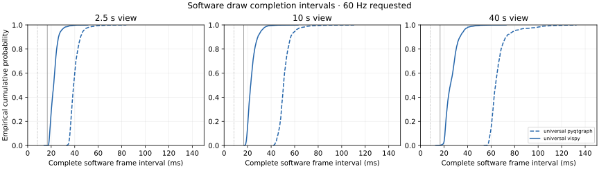

# VisPy rendering results

VisPy is selected for the annotation timeline and runtime plots. The production migration preserves the annotation
model, acoustic analysis, playback clock and LED algorithms.

## Evidence for migration

Universal, deterministic playback, 60 Hz requested, three independent 30-second runs per renderer/view with warm-up and
alternating renderer order. Values are medians of per-run statistics; these are actual software paint/draw completions,
not compositor presentation FPS.

| View  | Qt draw Hz | VisPy draw Hz | Qt P95 ms | VisPy P95 ms | P95 reduction | Qt / VisPy CPU % |
| ----- | ---------: | ------------: | --------: | -----------: | ------------: | ---------------: |
| 2.5 s |       25.1 |          44.4 |     47.30 |        28.05 |         40.7% |     100.7 / 92.5 |
| 10 s  |       19.4 |          42.5 |     60.56 |        31.51 |         48.0% |     100.5 / 94.8 |
| 40 s  |       15.2 |          37.8 |     81.56 |        36.77 |         54.9% |     100.4 / 93.8 |

Solid curves are VisPy, dashed curves are Qt. Vertical lines mark 8.3/16.7 ms. VisPy used roughly 73 MB more process RSS
in this initial comparison. Consistent 60/120 Hz was not established and is not a migration prerequisite.

The original collection stopped after 22 completed runs at the user's request. Short actual-PCM checks favored VisPy's
software cursor freshness: 10-second following cursor-gap P95 was 23.2 versus 52.6 ms; adaptive seeking was 34.6 versus
64.4 ms. Measured underruns were 0/0 for normal following and 2/0 for seeking (Qt/VisPy), with one initial warm-up
underrun in each VisPy run. These three-second checks do not establish physical synchronization or long-run audio
reliability.

## Selected waveform strategy

Short targeted checks on the same hardware compare four strategies, at 120 Hz requested, one three-second run per case.
These settle implementation choices, not statistical performance claims.

| Strategy                       | 2.5 s P95 ms | 120 s P95 ms | 2.5 s measured buffer payload MB | Precomputed CPU geometry MB |
| ------------------------------ | -----------: | -----------: | -------------------------------: | --------------------------: |
| Visible-range extrema          |        26.23 |        35.06 |                             4.91 |                           0 |
| Fully resident original PCM    |        45.09 |       336.21 |                            0.006 |                      121.73 |
| Fully resident envelope levels |        20.36 |        35.53 |                            15.22 |                       81.15 |
| Padded envelope window         |        21.57 |        34.80 |                            0.486 |                       81.15 |

**Retain padded multiresolution windows.** They preserve comparable pacing while reducing measured detailed-view
payloads by 97% relative to whole-track envelope residency and avoiding offscreen whole-track vertices. The window spans
two viewport widths and stays resident until the view leaves its padding or resolution changes. Initial/warm-up buffer
payloads fell from 6.27 to 2.69 MB. The pyramid takes about 0.65–0.69 seconds in the original measurements; direct
visible-range reduction starts faster but repeats PCM scanning. Original samples replace extrema at inspection zoom.
Extrema preserve transient amplitudes, sample order and incomplete final buckets.

Earlier profiling also justified caching marker colors and axis glyph geometry, and moving the cursor with a transform.
These optimizations were combined rather than independently benchmarked. Buffer payloads are CPU enqueue counts, not
physical GPU residency or bus traffic. Physical GPU memory/utilization were not reliably available.

## Wide-view draw gaps

A controlled nine-second 120-second-view check deliberately hid the window between seconds three and five. Updates
continued, while draw counts were 132 before hiding, five during the visibility transition, and 154 after showing again.
Visible-period maximum intervals were 37.3/52.8 ms; hiding reproduced the multi-second gap signature without an
expensive geometry update. The original gaps therefore provide no evidence of a wide-view algorithmic stall: external
visibility and presentation scheduling can produce them. Their exact original trigger was not recorded, so those four
runs remain flagged and excluded from headline comparisons. Future instrumentation records exposure alongside updates
and draws.

## Conditions and retained data

Hardware OpenGL: Intel UHD 620, Mesa 25.2.8, i7-8550U, Ubuntu/Wayland; a 60.011 Hz panel at 2× scaling. Primary windows
were 1180 × 620 logical pixels. Python 3.15.2, VisPy 0.17.0, PySide6 6.12.0 and PyQtGraph 0.14.0. Renderer
configuration, recording/correction identity, source hashes, raw intervals, resource counters, audio checks and earlier
profiling attribution are preserved losslessly in [the compressed measurement archive](vispy_measurements.json.gz).

A short streaming check demonstrated incremental buffer writes at 0.76 MB/s and 54.4 draws/s, with independent ingestion
and no overwritten pending data. Its three-second duration was insufficient to establish long-run stability. GPU timer
median/P95 was 2.52/5.80 ms; those asynchronous query intervals may include submission gaps. Production validation is
recorded with the migration checks rather than another benchmark campaign.

The original No Trust comparison and extensive matrix were not completed. The decision to migrate does not depend on
them. Hardware WLED delivery and physical audio-to-display alignment remain unverified. Historical Matplotlib/Qt reports
keep their original measurements. See [the harness](../../review_performance/README.md) for short reproducible checks.

## Production migration verification

The annotation editor now uses VisPy directly, without experimental inheritance or PyQtGraph dependencies. Editing,
saving, reclassification and DAC playback retain their existing models and orchestration. Padded local-coordinate
windows cover PCM, evidence, markers and beat grids; close zoom uses original samples. Omitting the expensive finest
pyramid levels reduces retained Universal preprocessing geometry from 81.2 to 30.4 MB and measured preprocessing from
roughly 0.65–0.69 to 0.33–0.38 seconds. Static axis layouts and hidden selections avoid redundant updates.

Runtime now displays raw power, processed intensities and a scrolling peak-preserving PCM envelope. History is
adjustable from one to ten seconds and independently disableable. A separate LED worker maintains animation and DDP
cadence independently of painting. Both renderers prepare only their latest state on actual draws; hidden windows cannot
build a FIFO of deferred waveform uploads. The rolling shader uses bounded integer sample coordinates and conditional
wrap arithmetic, avoiding a driver-sensitive modulo artifact. GPU readback checks exercise raw and envelope modes across
wraparound; window captures were inspected for both applications.

Automated desktop interactions exercised actual PCM playback, keyboard seeking, accumulated zoom, marker correction,
undo/redo, temporary-draft saving and resizing. The final audio smoke reported zero underruns. A 12-second simulated
runtime capture passed the 480,000-sample history boundary, displayed 46 detections and transmitted 1,361 loopback UDP
frames. During a deliberate 0.6-second GUI stall, capture advanced 28,672 samples and output transmitted 71 frames.
These are software/automated checks, not physical audio-to-display or hardware WLED validation.

Three-second production-path checks recorded P95 intervals of 37.6/44.9 ms for Universal 10/40-second views and 38.4 ms
for No Trust's 10-second view. They retain an advantage over the earlier Qt following measurements but are exploratory,
not paired statistical comparisons. The Universal checks preceded the final static-axis cache. Their raw data and the
GUI/readback checks are included under `migration_verification` in the measurement archive.

VisPy is a regular dependency; PyQtGraph and the experiment dependency group are removed. Headless capture and CLI
imports do not initialize Qt or VisPy. The old prototype renderers and duplicate reports are removed. Long-duration
memory stability, physical WLED delivery and physical synchronization remain unverified; no spectrogram was added.
